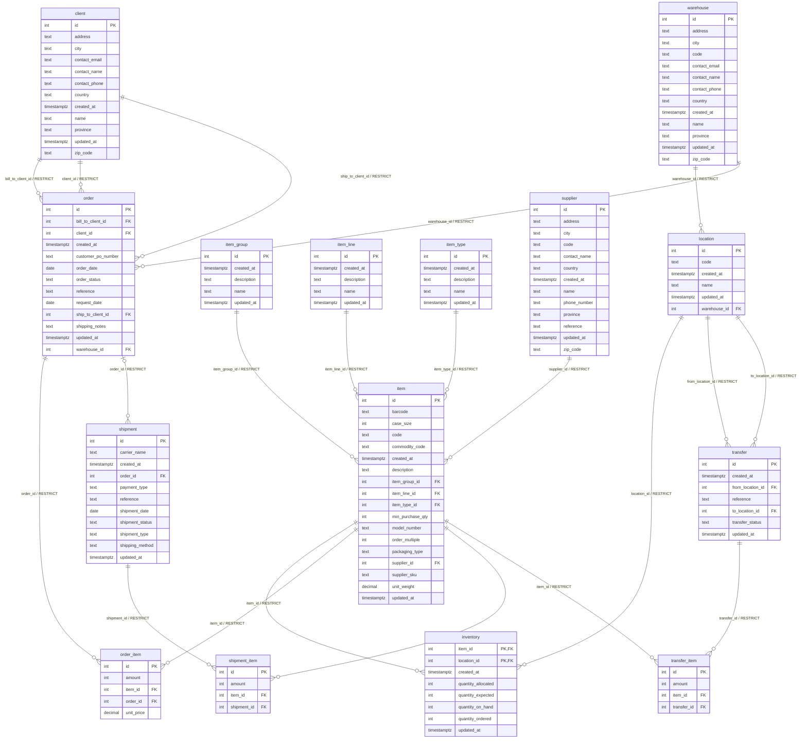

# CargoHub ERD — migratiebasis

Gegenereerd uit het EF Core-model. Niet handmatig aanpassen; zie CH-012-schema.md.

Alle kolommen zijn verplicht behalve `order.shipping_notes` en `shipment.order_id`. `inventory` heeft één samengestelde primary key: `(item_id, location_id)`.

## Check constraints

- `inventory.ck_inventory_allocation_within_stock`: `quantity_allocated <= quantity_on_hand`
- `inventory.ck_inventory_nonnegative`: `quantity_on_hand >= 0 AND quantity_expected >= 0 AND quantity_ordered >= 0 AND quantity_allocated >= 0`
- `order.ck_order_status`: `order_status IN ('Pending', 'Shipped')`
- `order_item.ck_order_item_nonnegative_price`: `unit_price >= 0`
- `order_item.ck_order_item_positive_amount`: `amount > 0`
- `shipment.ck_shipment_status`: `shipment_status IN ('Scheduled', 'Transit', 'Delivered')`
- `shipment_item.ck_shipment_item_positive_amount`: `amount > 0`
- `transfer.ck_transfer_different_locations`: `from_location_id <> to_location_id`
- `transfer.ck_transfer_status`: `transfer_status IN ('Scheduled', 'Processed')`
- `transfer_item.ck_transfer_item_positive_amount`: `amount > 0`

## Unieke combinaties

- `transfer_item`: `(transfer_id, item_id)`

## Standaardwaarden

- Enkelvoudige `id`-kolommen: PostgreSQL identity by default.
- `created_at` en `updated_at`: `CURRENT_TIMESTAMP` bij invoegen; updates wijzigen `updated_at` niet automatisch.
- `transfer_status`: `Scheduled`.
